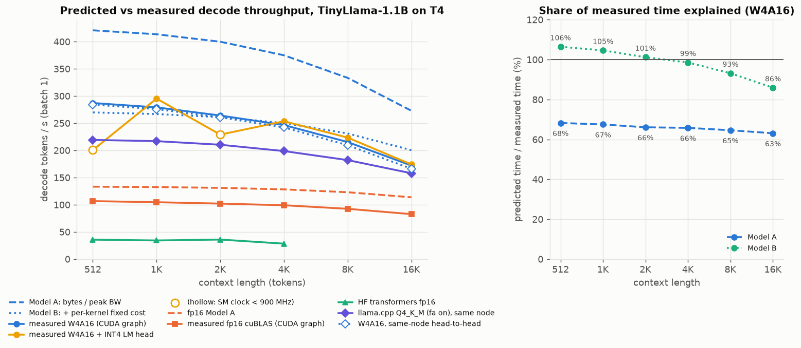
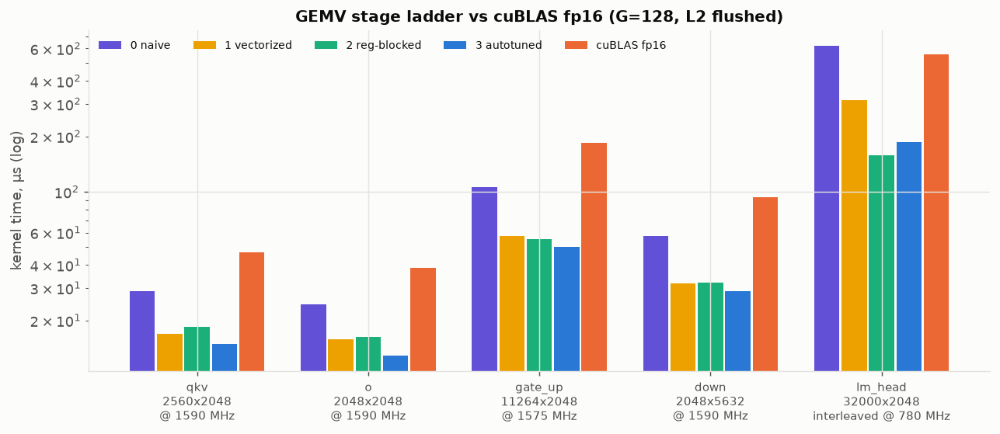
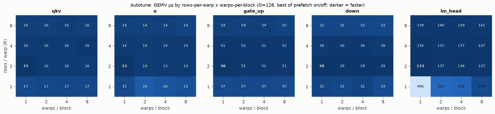
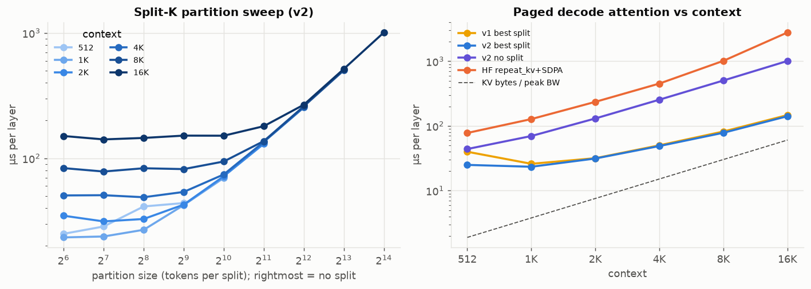
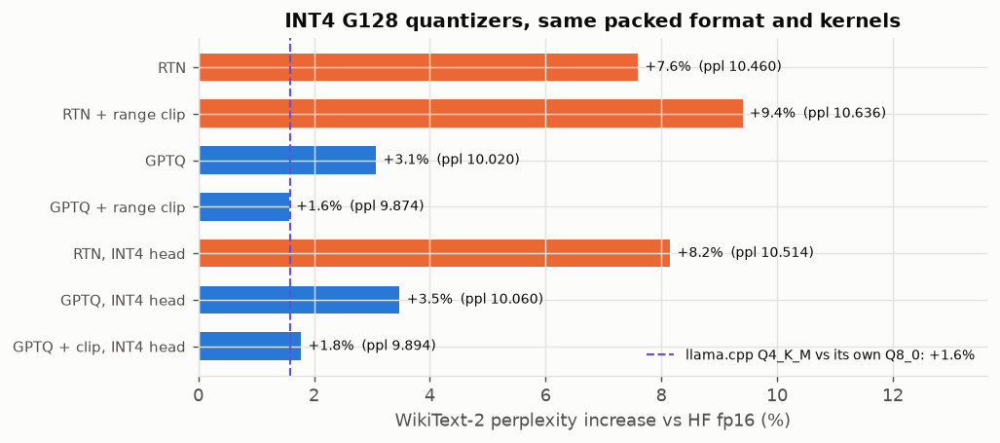
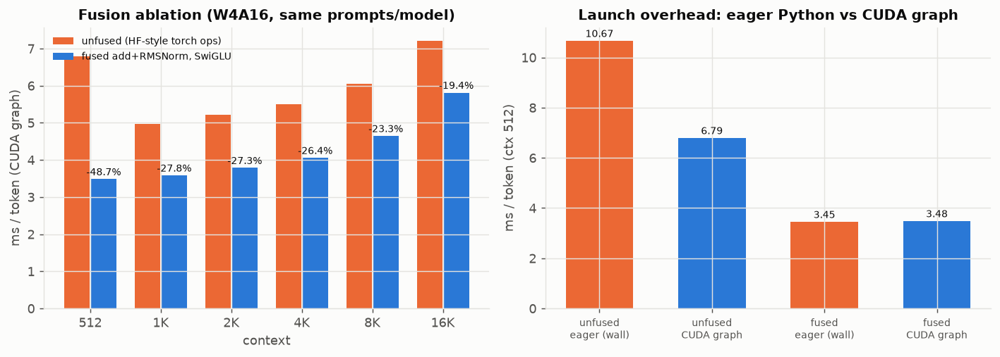
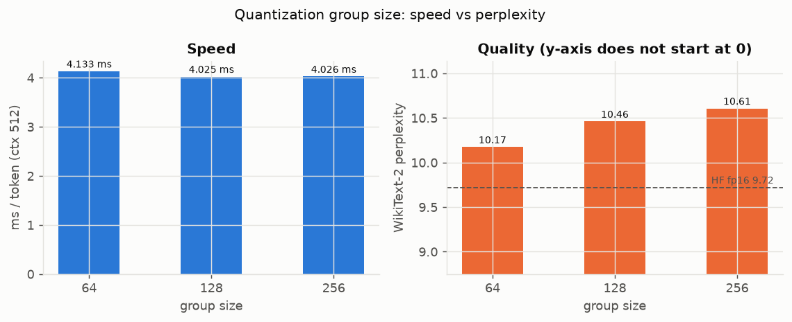
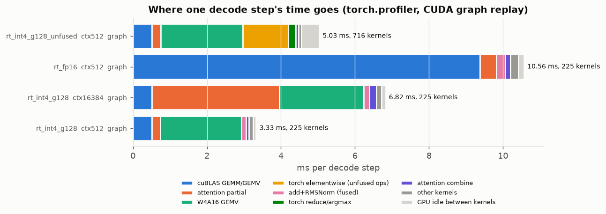
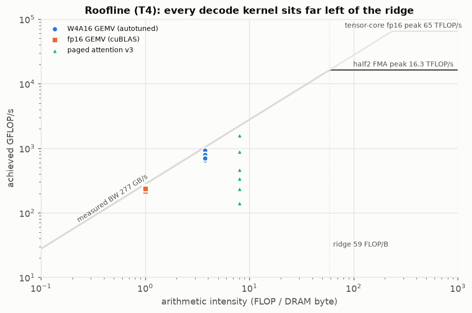
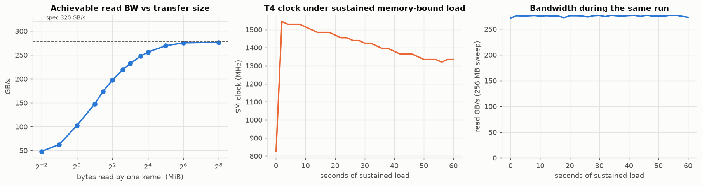

# Results — low-latency W4A16 decode kernels, TinyLlama-1.1B on a Tesla T4

Batch-1 greedy decode, CUDA-graph replay, everything below measured on Kaggle T4s (sm_75, 320 GB/s spec,
**277 GB/s achievable** by our own read microbenchmark). Every speed number has its accuracy number next to it;
every speed number was produced only after the accuracy gate (`tests/test_kernels.py`) exited 0 in the same job —
**667/667** with the final suite (§3).

Sources (merged into `results.json` by `scripts/plot_all.py`, later runs override earlier keys):
`runs/20261011T170804Z_kbench2` (bandwidth, clock probe, autotuner, group sweep, clean v1/v2 attention points),
`runs/20261011T212701Z_final` (attention v1/v2/v3 sweep and policy, GEMV ladder rerun),
`runs/20261011T193218Z_e2e4` (perplexity, greedy agreement), `runs/20261011T225704Z_e2efinal` (end-to-end speed and
profiles with attention v3 and the fixed split-size lookup), `runs/20261011T102433Z_llamacpp2` and
`runs/20261011T205851Z_llamappl` (llama.cpp speed and perplexity), `runs/20261011T191452Z_kbench3` (a node stuck at
585 MHz — clock-sensitivity control only), `runs/20261012T060832Z_quant2` (quantizer comparison incl. GPTQ, interleaved
LM-head ladder; `…054806Z_quant` is its identical-perplexity repeat) and `runs/20261011T225838Z_lmhead` (a failed
LM-head clock attempt, §4).

> **Clock caveat, up front.** Kaggle does not allow clock locking (`nvidia-smi -lgc`: permission denied), and the
> T4 throttles under sustained load. Kernel microbenchmarks (short, with idle gaps) ran at **1470–1590 MHz** where
> stated. The end-to-end decode loops ran in NVML `hw_slowdown` at **1080–1170 MHz** (W4A16 G128), 930–990 MHz (fp16
> runtime) and 585–1035 MHz (INT4-head config), after a cool-down to < 60 °C before each point. Every such row is
> flagged `throttled` in `results.json`. These are what this platform delivers, not best-case T4 numbers.

## 1. Headline

| ctx | **W4A16 (G128, fp16 head)** | W4A16 + INT4 head | fp16 (our runtime, cuBLAS) | HF transformers fp16 | llama.cpp Q4_K_M (FA on) |
|---:|---:|---:|---:|---:|---:|
| 512 | **287.1** | 200.5 † (wall 309.2) | 106.6 | 35.8 | 219.3 |
| 1K | 279.1 | **295.2** | 104.6 | 34.3 | 216.4 |
| 2K | **264.1** | 229.0 † (wall 283.5) | 102.0 | 35.9 | 210.9 |
| 4K | 246.5 | **253.5** | 99.0 | 28.4 | 199.9 |
| 8K | 215.2 | **223.4** | 92.5 | OOM | 183.3 |
| 16K | 172.0 | **174.0** | 82.7 | OOM | 159.6 |

decode tokens/s, batch 1 (median of CUDA-event-timed graph replays). † SM clock sampled at 585 / 780 MHz for that
point; the wall-clock rate of the same loop is given beside it (hollow markers in the plot). HF =
`model(next_token, past_key_values=…)` loop, wall-clock; it runs out of memory in the 8K/16K prefill on the 15 GB T4.
llama.cpp = `llama-bench -n 128 -d <ctx>`, a different Kaggle node, and llama-bench does not record clocks.

**With accuracy next to it** (WikiText-2 test, 16 windows × 512 tokens = 8,176 scored tokens, BOS-prefixed;
greedy agreement vs HF fp16 on 16 fixed prompts × 64 new tokens):

| config | perplexity | Δ vs HF fp16 | greedy exact match | mean first divergence | teacher-forced top-1 agreement | weights read / token |
|---|---:|---:|---:|---:|---:|---:|
| HF transformers fp16 | 9.722 | — | — | — | — | 2.07 GB |
| our runtime fp16 | 9.721 | −0.004 % | 15/16 | 60.6 / 64 | 0.9990 | 2.07 GB |
| W4A16 G64 | 10.173 | +4.6 % | 2/16 | 13.0 | 0.9111 | 0.68 GB |
| **W4A16 G128** | 10.461 | +7.6 % | 1/16 | 14.3 | 0.9102 | 0.65 GB |
| W4A16 G256 | 10.607 | +9.1 % | 0/16 | 6.1 | 0.8896 | 0.63 GB |
| W4A16 G128 + INT4 LM head | 10.515 | +8.2 % | 1/16 | 11.8 | 0.9082 | 0.55 GB |
| W4A16 G128, RTN + MSE range clipping | 10.636 | +9.4 % | 1/16 | 9.8 | 0.8916 | 0.65 GB |
| W4A16 G128, **GPTQ** | 10.020 | +3.1 % | 1/16 | 12.3 | **0.9326** | 0.65 GB |
| W4A16 G128, **GPTQ + range clipping** | **9.874** | **+1.6 %** | 1/16 | 11.6 | 0.9102 | 0.65 GB |
| W4A16 G128, GPTQ + clipping, GPTQ INT4 LM head | 9.894 | +1.8 % | 1/16 | 11.9 | 0.9033 | 0.55 GB |

The last three rows (`runs/20261012T060832Z_quant2`, identical in `…054806Z_quant`) use the **same packed format, the
same kernels and the same bytes per token** as the RTN row — only the INT4 values differ (§6, "Quantizers").

| llama.cpp (`llama-perplexity -c 512`, full WikiText-2 test, own protocol) | perplexity | Δ vs its Q8_0 |
|---|---:|---:|
| Q8_0 | 19.975 ± 0.167 | — |
| Q4_K_M | 20.292 | **+1.6 %** |

(llama-perplexity scores only the second half of each 512-token chunk and adds no BOS, so its absolute values are not
comparable to ours; the relative cost of 4-bit quantization is.)

Reading it honestly:

* **Our fp16 path is numerically HF.** Same perplexity to 4 decimals; 15/16 greedy continuations identical for all 64
  tokens; the 16th diverges at token 9 (fp16 accumulation-order differences flip a close argmax).
* **The INT4 quality cost depends on the quantizer, not the kernels.** Plain round-to-nearest (RTN) costs +7.6 %
  perplexity at G128. **GPTQ** (calibrated on 128 × 512 tokens of WikiText-2 *train*, 2 min on the T4) brings that to
  +3.1 %, and GPTQ with per-group range clipping to **+1.6 %** — with no kernel change and no speed change (§6). Greedy
  text still matches HF exactly in only 1 of 16 prompts for every INT4 variant: free-running 64-token exact match against
  fp16 is a very strict test (one flipped near-tie and the continuations part), and on this 16-prompt set it does not
  separate the quantizers; teacher-forced top-1 agreement does (0.910 RTN → 0.933 GPTQ). The kernels reproduce the fp16
  reference dequant-and-GEMV to ≤ 6.5e-4 relative error (§3), so none of this is kernel error.
* **vs llama.cpp: faster at every context, and with GPTQ + clipping, equal quality cost.** +31 % at 512 tokens, +25 %
  at 2K, +17 % at 8K, +8 % at 16K. Attention v3 (§5) is what closed the long-context gap: with v2 we were 16 % *slower*
  than llama.cpp at 16K. On quality, llama.cpp's Q4_K_M loses **1.6 %** perplexity to its 8-bit model; our RTN lost
  7.6 % to fp16, our GPTQ + clipping loses **1.6 %** — the same relative cost (different perplexity protocols, so
  compare the relative numbers only; Q4_K_M also spends ~4.9 bits/weight vs our 4.25 at G128). The speed numbers were
  measured with RTN weights; GPTQ weights run at the same speed (same bytes; measured, §6). llama.cpp ran on a
  different Kaggle node with unrecorded clocks.
* **vs HF fp16:** 8.0× at 512 tokens. vs our own fp16 cuBLAS runtime (same kernels for everything except the weight
  GEMVs): 2.7× in the timed loop, which ran the fp16 config ~180 MHz lower; the profiled graph steps at 512 tokens are
  10.54 ms vs 3.30 ms = **3.2×**, the same as the ratio of bytes per token (2.08 GB vs 0.66 GB).

TinyLlama is trained to 2,048 positions. Beyond 2K the KV cache is filled with random values and only **speed** is
meaningful there (quality claims stop at 2K).



## 2. Predicted vs measured: does "bytes moved" explain time per token?

Two models, **neither fitted to the end-to-end numbers** (`bench/analyze.py`):

* **Model A** — `t = bytes(ctx) / 277 GB/s` (weights + KV cache + activations; pure roofline).
* **Model B** — `t = bytes(ctx) / BW_fit + n_kernels × (t0 + gap)`; `BW_fit` = 278.3 GB/s and `t0` = 5.6 µs from a
  linear fit of the read-bandwidth-vs-transfer-size sweep (fixed cost of one memory-bound kernel), `n_kernels` = 225
  and `gap` = 0.36 µs from the profiler's graph-replay trace.

| ctx | bytes / token | measured | Model A | Model B | A explains | **B explains** |
|---:|---:|---:|---:|---:|---:|---:|
| 512 | 659 MB | 3.48 ms | 2.38 ms | 3.71 ms | 68 % | **106 %** |
| 1K | 671 MB | 3.58 ms | 2.42 ms | 3.75 ms | 67 % | **105 %** |
| 2K | 694 MB | 3.79 ms | 2.50 ms | 3.83 ms | 66 % | **101 %** |
| 4K | 740 MB | 4.06 ms | 2.67 ms | 4.00 ms | 66 % | **99 %** |
| 8K | 832 MB | 4.65 ms | 3.00 ms | 4.33 ms | 65 % | **93 %** |
| 16K | 1017 MB | 5.81 ms | 3.67 ms | 4.99 ms | 63 % | **86 %** |

**Bytes alone explain about two thirds.** Adding a fixed per-kernel cost explains the measured time **within ±7 % up
to 8K**, and 86 % at 16K. The profiler says where the remaining time goes (graph replay, `torch.profiler`, same config):

| µs per token | ctx 512 measured | bytes / BW | ctx 16K measured | bytes / BW |
|---|---:|---:|---:|---:|
| W4A16 GEMVs (88 launches) | 2,193 | 1,859 | 2,225 | 1,859 |
| fp16 LM head (cuBLAS) | 511 | 473 | 513 | 473 |
| attention partial + combine (44) | 262 | 42 | **2,002** | **1,333** |
| norm, SwiGLU, RoPE+append, argmax, embed (93) | 248 | ≈0 | 272 | ≈0 |
| GPU idle between kernels | 82 | — | 103 | — |
| **step span (profiled)** | **3,296** | | **5,115** | |

* **Short context — Model B over-predicts** (3.71 ms vs 3.48 ms timed, 3.30 ms profiled). The time above bytes/BW is
  GEMVs at 85 % of achievable bandwidth (small GEMVs pay a launch-to-first-byte cost — a 2.8 MB read reaches only
  ~180 GB/s in the size sweep), plus ~90 latency-bound tiny kernels (attention at 512 tokens moves 11.5 MB of KV cache in
  262 µs). `t0` = 5.6 µs is measured on isolated launches and includes overhead that graph replay hides, so 225 × t0
  slightly overstates it.
* **16K — the miss is attention.** Model B is 0.82 ms short of the timed step. Attention takes 2.00 ms for 369 MB →
  **184 GB/s in the graph, 66 % of achievable** (v2 managed 102 GB/s); its excess over bytes/BW is 0.67 ms, **81 % of
  the miss**. The remaining ~0.15 ms is the timed loop's lower clock (against the profiled 5.11 ms step, Model B is
  within 2.4 %). A Model B that used *measured* attention bandwidth would be descriptive, not predictive, so we report
  the miss instead. Why attention is still below the GEMVs' bandwidth: §5.

## 3. Kernel accuracy (the gate)

`tests/test_kernels.py`, run first in every GPU job; any failure exits non-zero before a speed number exists. Final
suite: **667/667** (`runs/20261011T225838Z_lmhead`, and again in `e2efinal`); earlier runs passed the then-current
suite (439/439 before attention v3, 538/538 with v3 before the runtime-condition cases were added).

| kernel group | tests | max abs err | max rel err | tolerance (rel) |
|---|---:|---:|---:|---:|
| GEMV shape-1 sanity (4-row hand-checked, one-hot over all 128 columns, every stage/config) | 52 | **0** | **0** | exact |
| GEMV real shapes × G ∈ {64,128,256} × all stages/configs | 170 | 3.9e-3 | 6.5e-4 | 5e-3 |
| paged attention shape-1: ctx 128 vs contiguous reference (head configs q/kv heads 32/4, 16/4, 8/4, 8/8, page 16/32, split sizes, v1/v2/v3) | 120 | 1.2e-4 | 2.2e-4 | 2e-3 |
| paged attention ctx 1 – 16K (1, 2, 17, 63, 65, 129, 512, 1000, 1024 … 16384), uniform and peaky scores, split sizes 64–8192, v1/v2/v3 | 243 | 9.8e-4 | 3.6e-4 | 2e-3 |
| paged attention under runtime launch conditions: ctx {1, 40, 64, 100, 700, 2048, 5000} × split {64, 128, 256}, 8 spare split buffers, v1/v2/v3 | 63 | 9.8e-4 | 2.9e-4 | 2e-3 |
| fused add + RMSNorm, SwiGLU, RoPE + paged KV append | 19 | 9.8e-4 | 2.7e-4 | 2e-3 |

The references are the fp16 PyTorch ops in `reference/ref_ops.py` (HF rounding order). The GEMV reference dequantizes
with the same fp16 scale/zero, so the error is accumulation order only; the shape-1 cases are exact.

## 4. W4A16 GEMV

Format: asymmetric RTN INT4, group size G along K, fp16 scale + zero per group, 8 nibbles per `int32` in an interleaved
order so that `(w >> 4i) & 0x000F000F | 0x64006400` yields two halves `1024 + q` (the "magic number" dequant: one
`lop3`-style op + one `hsub2` per 2 weights, no int→float converts). One warp per row (or R rows), 128-bit
`ld.global.nc.L1::no_allocate` weight loads, `__half2` FMA within a 16-byte chunk then fp32 accumulation,
`__shfl_xor_sync` reduction.

Stage ladder at G128, L2 flushed between iterations (a 16 MB *read* — see NOTEBOOK for why a memset flush was a bug),
SM 1590 MHz (`kbench2`):

| shape (N×K) | 0 naive | 1 vectorized | 2 reg-blocked | **3 autotuned** | cuBLAS fp16 | speedup vs cuBLAS | % of 277 GB/s |
|---|---:|---:|---:|---:|---:|---:|---:|
| qkv 2560×2048 | 28.8 µs | 17.0 | 18.6 | **15.1** | 46.8 | 3.1× | 67 % |
| o 2048×2048 | 24.5 | 15.8 | 16.3 | **13.1** | 38.8 | 3.0× | 62 % |
| gate_up 11264×2048 | 106.0 | 57.0 | 55.2 | **50.3** | 184.3 | 3.7× | 88 % |
| down 2048×5632 | 57.3 | 32.2 | 32.6 | **29.1** | 94.1 | 3.2× | 76 % |
| lm_head 32000×2048, **interleaved, all at 780 MHz** ‡ | 620.9 | 312.7 | **158.3** | 186.4 | 556.6 | **3.0×** (3.5× vs stage 2) | — |
| lm_head at full clock (autotuner grid, ~1500 MHz) | | | | **133.3** | | | 95 % |

‡ The LM-head rows never came out at full clock when timed one after another: in kbench2, `final`, a dedicated job that
cooled the GPU to 40 °C before every row (`lmhead`) and a burst-timed job (`quant`), the SM clock sampled during the
LM-head loops was 585–1110 MHz with no NVML throttle reason, while the short body-shape loops in the same jobs ran at
1590 MHz — and the first two showed the rows at *different* clocks, so their ratios were meaningless. The fix
(`kernel_bench.py gemv_lm`, `bench.timing.time_interleaved`): run the four stages and cuBLAS **round-robin**, one call
each per round with the L2 flushed before each, 40 rounds — every variant sees the same clock history, so the ratios
are valid on any node (`quant2`: rounds at 585–915 MHz, median 780). Absolute full-clock time for the autotuned config
is the grid's 133.3 µs. The body rows reproduce within 1 % in a second run (`final`, all at 1575–1590 MHz).
End-to-end at ctx 512 the ladder is 118.8 → 205.0 → 246.7 → 287.1 tok/s (stages 0 → 3, `e2efinal`; the stage-3 point
ran at 1170 MHz, stages 0–2 at 990–1050 MHz, so the last step is partly clock).

* **Vectorization is the big step** (1.55–1.86× on the body shapes at 1590 MHz): 32-bit → 128-bit loads, and it needs the alignment work — packed rows
  are K/8 int32 = 16-byte multiples for every shape here, `x` is 16-byte aligned (checked in the bindings: `CHECK_ALIGN16`).
* **Register blocking matters only where `x` traffic is a real fraction of the bytes**: for the body shapes the 4 KB
  activation stays cache-resident and R=1→2 is worth 10–14 %; for the LM head (32,000 rows) the best R=1 cell is
  170 µs vs 133 µs at R=2 (+28 %; the 1–4-warp R=1 cells, 216–406 µs, were partly measured throttled). At the same
  780 MHz clock (interleaved run), vectorization and register blocking are each worth ~2× on the LM head (621 → 313 →
  158 µs).
* **The autotuned config is clock-dependent on the LM head:** tuned at ~1500 MHz it picks R=2 / 1 warp (133.3 µs vs
  the stage-2 config's 139.9 µs in the same grid); at 780 MHz the stage-2 config (R=4, 4 warps, prefetch on) is **15 % faster**
  (158 vs 186 µs). At low SM clock the kernel is issue-bound (§4 clock-sensitivity bullet), and more rows per warp
  amortize the per-chunk scale/zero and `x` work over more weights. The runtime uses the full-clock choice; a
  clock-aware table would be a cheap follow-up.
* **Occupancy vs ILP, resolved by sweep:** the autotuner (R ∈ {1,2,4,8} × warps/block ∈ {1,2,4,8} × prefetch on/off ×
  G ∈ {64,128,256}, 480 cells, `configs/autotune.json`, loaded by the runtime at startup) picks **R=2, 1 warp/block**
  for 14 of 15 shape×G cells (prefetch off in 12 of 15). Many small blocks (occupancy) beat deeper per-thread ILP.
* **Manual double-buffering** (register prefetch of the next 128-bit chunk — Turing has no `cp.async`) **won 0 of 12
  body cells** and the LM head only within noise (133.3 vs 133.9 µs). With enough warps resident, the memory system
  already has the requests it needs in flight.
* **Clock sensitivity (kbench3 control, same kernels at 585 MHz):** our INT4 GEMVs slow **1.69–1.79×**, cuBLAS fp16 only
  **1.10–1.36×**, while the pure read benchmark held 275 GB/s as the clock fell from 1550 to 1330 MHz in the clock probe.
  The INT4 GEMV is *not* purely bandwidth-bound: dequant is 4–5 ALU ops per 2 weights, and at low SM clock the kernel
  becomes issue-bound. On a throttled T4 this is the single biggest reason end-to-end lands below Model B.

 

## 5. Paged decode attention (split-K / flash-decoding)

KV cache `[layer, K/V, page, kv_head, 16 tokens, 64]` fp16, pages handed out by a **randomly permuted** block table (so
"paged" is actually exercised). One CTA per (kv head, split) handles all 8 query heads of the GQA group with an online
softmax, writes unnormalized partials + (m, l) per split, then a combine kernel merges the splits. The context length is
read from a device-side `pos`, so one captured CUDA graph is valid at every step. Version and partition size per
context come from `configs/attn_policy.json` (written by the sweep, loaded at startup). Three versions:

* **v1** — the straightforward kernel: 64-token chunks, scores → shared memory → softmax → V, barriers between.
* **v2** — v1 plus manual prefetch: K/V loads for all slots of a chunk issued at its start (no `cp.async` on Turing).
* **v3** — barrier-free main loop: each of the CTA's 4 warps owns its own 16-token chunks with its own online-softmax
  state, prefetches the next chunk's K/V into registers while computing the current one, and the warps' (m, l, acc)
  are merged once at the end. Selected by the sweep (geometric mean over contexts) and used for all end-to-end numbers.

Same-node comparison (`final`; per layer, 32 q heads, 4 kv heads, d=64; best partition size per version):

| ctx | v1 best | v2 best | **v3 best** | v3 / v2 speedup | v3 no split | HF repeat_kv + SDPA (contiguous) | SM MHz (v3 best) |
|---:|---:|---:|---:|---:|---:|---:|---:|
| 512 | 34.3 µs | 33.7 | **29.7** | 1.14× | 65.3 | 154.2 | 585 |
| 1K | 50.2 | 46.5 | **35.6** | 1.31× | 112.4 | 281.5 | 585 |
| 2K | 71.7 | 68.6 | **49.2** | 1.40× | 208.8 | 536.5 | 585 |
| 4K | 112.6 | 112.6 | **71.2** | 1.58× | 401.4 | 1044.5 | 585 |
| 8K | 192.9 | 172.0 | **75.3** | 2.28× | 330.9 | 940.8 | 1020 |
| 16K | 144.1 | 135.3 | **84.0** | 1.61× | 606.5 | 2576.7 | 1590 |

This node sat at 585 MHz for most of the sweep (88 of 117 points flagged), so read the table **across a row**: within
a row the versions ran at the same clock, except 8K where v2's best point sampled 690 MHz and v3's 1020. The 16K row is
clean for all three (1575–1590 MHz). For absolute v1/v2 numbers at full clock see kbench2 (v2 best split 25.0 / 23.4 /
31.3 / 48.9 / 78.4 / 141.4 µs from 512 to 16K at 1470–1590 MHz; its 512 point and v1's 1K point were throttled).

* **v3 vs v2: 1.14× at 512 growing to 1.6–2.3× from 4K up.** At 16K and full clock v3 reaches **200 GB/s per layer
  (72 % of achievable)** against v2's 124 GB/s. v2's three `__syncthreads` per chunk made the 4 warps load, compute and
  wait in lockstep, so a CTA's DRAM requests came in bursts; v3's warps drift independently and keep requests in flight.
  In the end-to-end graph this cut attention at 16K from 3.6 ms to 2.0 ms per token (§2) and took the 16K throughput
  from 126.6 to 172.0 tok/s — not all of that is v3: the old e2e4 run also used the buggy split-size lookup (NOTEBOOK)
  and ran ~45 MHz lower.
* **Split-K is always on:** with only 4 KV heads a no-split launch is 4 CTAs on a 40-SM GPU, so splitting wins at every
  context (2.2× at 512, 7.2× at 16K for v3). The crossover is in *partition size*: v3's best partition grows with
  context, 64 tokens at 512 → 128 (1K–2K) → 256 (4K) → 512 (8K) → 1024 (16K), longer than v2's (64–256) because each
  v3 CTA already runs 4 independent streams, so fewer, longer splits amortize the combine without starving the SMs.
* **vs PyTorch:** 5.2× (512) to 30.7× (16K) faster than HF's own path (repeat_kv + SDPA on a contiguous cache), while
  reading a paged cache.
* **What is left:** at 16K attention still runs at ~66 % of achievable bandwidth in the graph (184 GB/s) versus 85 % for
  the GEMVs, and short contexts are latency-bound (0.5 MB of KV per layer at 512 tokens in ~30 µs). The remaining overhead is the
  per-warp merge, the combine kernel and the score→probability math on the critical path; `ncu` was blocked (§8), so
  stall reasons are inferred, not measured.



## 6. Fusion, CUDA graphs, group size, INT4 LM head

**Fusion ablation** (fused residual-add + RMSNorm, fused SiLU·mul vs the same runtime with HF-style torch ops; profiled
graph-replay step span, `e2efinal`): 225 vs 716 kernels per token, **3.30 vs 4.99 ms at 512 (−34 %), 5.11 vs 6.65 ms at
16K (−23 %)**; in the timed loop's wall clock (the plot) −30 % at 512 and −19.5 % at 16K. The unfused path spends ~1.5 ms per token in elementwise and reduction kernels and 0.5 ms idle between
its 716 launches.

**CUDA graphs vs eager** (wall clock per token for both, same job): the fused runtime is within noise (**3.42 ms graph vs
3.45 ms eager** at 512, 5.75 vs 5.77 ms at 16K) — the CPU issues 225 launches faster than the GPU drains them. With 716
kernels the CPU cannot keep up: **4.87 ms graph vs 10.67 ms eager** at 512 (2.2×), 7.15 vs 11.30 ms at 16K (the profile
shows 15 ms of GPU idle per eager step). Graphs matter in proportion to kernel count; fusion and graphs are complementary.

**Group size** — one configuration in every column: INT4 transformer body at group size G, **fp16 LM head** (the head
is 125 MiB and identical in every row, so it is left out of the byte and GEMV columns). GEMV speed is the per-token sum
from the autotuner grid at ~1500 MHz; e2e is the throttled decode loop in e2e4, where the three configs ran at similar
clocks (900–930 MHz) — in e2efinal their clocks differ by up to 210 MHz, which would swamp a 3 % effect:

| G | body weight MiB / token | body GEMV µs / token | e2e ms / token @512 | perplexity |
|---:|---:|---:|---:|---:|
| 64 | 520 | 2,512 (+6 %) | 4.13 | **10.17** |
| 128 | 491 | 2,367 | 4.03 | 10.46 |
| 256 | 476 | 2,317 (−2 %) | 4.03 | 10.61 |

G64 closes 39 % of the INT4-vs-fp16 perplexity gap for +6 % GEMV time (≈ +3 % end-to-end); G256 saves 2 % and gives
back 0.15 perplexity. **If quality matters, G64 is the better operating point**; G128 stays the default only because it
is the brief's spec.

**INT4 LM head** — the data-driven call from the profile: the fp16 LM head is 131 MB, **20 % of all bytes per token
and 511 µs (15 %) of the step** at 512 context. Quantizing it (G128, our GEMV, ≈ 133 µs) gives **+12.6 % tok/s at 512
and +6 % at 16K** in e2e4, where both configs ran at matched clocks (930 MHz at 512). In e2efinal the INT4-head config
ran ~100 MHz *lower* than the fp16-head one and still came out +1–6 % from 1K to 16K (its 512 and 2K points sampled
585/780 MHz — flagged †, §1). Cost: +0.05 perplexity (10.46 → 10.51), top-1 agreement 0.910 → 0.908. Worth it, so it is
the runtime default (`lm_head="auto"`: INT4 whenever the body is INT4); the benchmark configs pin the head explicitly.
(Embedding stays fp16: it is one 4 KB row gather per token, 4 µs in the profile — not worth a kernel, per the brief's
"only if profiling says so".)

**Quantizers** — same INT4 G128 format (`runtime/quant.py`, fp16 scale + integer zero per group, nibble-packed),
same kernels; only the choice of the 4-bit values changes (`bench/e2e.py quant`):

| quantizer | perplexity | Δ vs fp16 | teacher-forced top-1 | ms / token @512, wall (A/B/A/B) | ms / token @4K, wall |
|---|---:|---:|---:|---:|---:|
| RTN (round to nearest, min/max range) | 10.460 | +7.6 % | 0.910 | 3.61 / 3.68 | 4.28 / 4.32 |
| RTN + per-group MSE range clipping | 10.636 | +9.4 % | 0.892 | — | — |
| GPTQ | 10.020 | +3.1 % | **0.933** | — | — |
| **GPTQ + range clipping** | **9.874** | **+1.6 %** | 0.910 | 3.69 / 3.74 | 4.35 / 4.34 |

* **GPTQ** (`runtime/gptq.py`, Frantar et al. 2022): quantize each weight column left to right and push its rounding
  error onto the not-yet-quantized columns through the inverse Hessian of the layer input, H = 2XᵀX over the calibration
  tokens — minimising the error of the layer's *output*, not of the weights. Calibrated sequentially (layer i sees the
  outputs of the already-quantized layers 0..i−1), 128 × 512 tokens of WikiText-2 **train** (perplexity is on test),
  damping 1 % of mean diag(H), no act-order (act-order would permute columns and break the contiguous groups the kernel
  reads). 120 s on the T4 for all 89 matrices (q|k|v and gate|up share an input, so each pair/triple is one GPTQ call). It is deterministic: two runs gave identical perplexities to 4 decimals.
* **Range clipping alone hurts (+9.4 % vs +7.6 %)** although it lowers every group's weight MSE (that is what it
  minimises): shrinking a group's range clips its largest weights, and in an LLM the largest weights are
  disproportionately the ones that matter. **Inside GPTQ the same clipping helps** (+3.1 % → +1.6 %): GPTQ compensates the
  clipped error on the other columns, so the finer grid is a net win. Weight error is the wrong objective; output error
  is the right one.
* **Speed is unchanged**, as it must be — identical bytes and instructions: measured wall-clock per token, RTN and GPTQ
  timed alternately A/B/A/B on one node, agree within the run-to-run spread (≤ 2 %).
* **Recommended operating point: GPTQ + clipping at G128 with the INT4 LM head** (9.894, +1.8 %, 0.55 GB per token):
  the best speed config and within 0.2 % of the best quality. Use: `qp = runtime.gptq.calibrate(hf_model, tokenizer,
  clip=True)`, then `DecodeConfig(quant="pre", qparams=qp)`. RTN stays the zero-setup default (no calibration data needed).



  

## 7. Roofline

Arithmetic intensity: W4A16 GEMV ≈ 3.8 FLOP/byte, fp16 GEMV ≈ 1, decode attention ≈ 8 (8 q heads share each KV byte).
The T4 ridge is **59 FLOP/byte against the `__half2` CUDA-core peak** (2,560 lanes × 2 × 2 FLOP × 1.59 GHz ≈ 16.3 TFLOP/s
over 277 GB/s) and ≈ 235 against the 65 TFLOP/s tensor-core peak — none of these kernels uses tensor cores, so 59 is
the relevant one. **Every decode kernel is 7–59× left of it** (attention 7×, W4A16 GEMV 15×, fp16 GEMV 59×): decode is
a bandwidth problem, and the only compute concern is the dequant issue rate at throttled clocks (§4). The achieved
points sit at 62–95 % of measured bandwidth for the GEMVs; attention v3 reaches 72 % at 16K (full clock), while its
short-context points are latency-bound and were measured on the 585 MHz node (§5).

 

## 8. Platform notes and limitations (stated, not hidden)

* **Turing (sm_75):** no `cp.async` → manual register double-buffering (GEMV prefetch, attention v2 slot prefetch, attention v3
  per-warp next-chunk prefetch);
  no bf16 → fp16 everywhere with `__half2` math and fp32 accumulation across chunks; no `ldmatrix`-based W4 tensor-core
  path was attempted.
* **Prefill** is not a separate kernel: prompt tokens are teacher-forced through the decode step (one graph replay per
  token). Correct and simple; slow for long prompts. The WMMA prefill GEMM stretch goal was **cut** for time, as the
  brief allows.
* **`ncu` blocked** (`ERR_NVGPUCTRPERM`: Kaggle does not expose performance counters); **`nsys` not available**.
  `torch.profiler` (CUPTI activity tracing, no counters) was used for per-kernel timing, idle gaps and kernel counts.
* **Clock control:** not permitted; see the caveat at the top. The timing harness samples NVML clocks *while the GPU is
  busy*, retries after cool-downs, and flags every throttled measurement (the first version sampled after
  `synchronize()` and read the 585 MHz idle clock — NOTEBOOK).
* **Quantization:** RTN is the zero-setup default; GPTQ + clipping (one 2-minute calibration) closes the perplexity gap
  to llama.cpp Q4_K_M's relative cost (§6). AWQ and act-order GPTQ were not tried.
* **llama.cpp** was measured on a different Kaggle node (`llama-bench` doesn't record clocks), with its own quantizer;
  its perplexity uses its own protocol, so only the relative 4-bit cost is compared (§1).
* **LM-head GEMV ladder** never ran at full clock on Kaggle when timed row by row (four jobs); it is now timed
  interleaved, so its ratios are valid, at 780 MHz; its full-clock absolute time comes from the autotuner grid (§4).

## 9. Reproduce

`README.md`: one command (`scripts/kaggle_run.py --cmd "bash scripts/run_all.sh"`), then `scripts/plot_all.py` over the
run's `results.json`. All numbers above are in `results.json`; all figures regenerate from it. The merged file in this
repo was produced with

```bash
.venv/bin/python scripts/plot_all.py runs/20261011T170804Z_kbench2/results.json runs/20261011T193218Z_e2e4/results.json \
  runs/20261011T191452Z_kbench3/clock_experiment.json runs/20261011T212701Z_final/results.json runs/20261012T060832Z_quant2/results.json \
  runs/20261011T225704Z_e2efinal/results.json \
  --llamacpp runs/20261011T102433Z_llamacpp2/llamacpp.json --llamacpp-ppl runs/20261011T205851Z_llamappl/llamacpp_ppl.json
```
